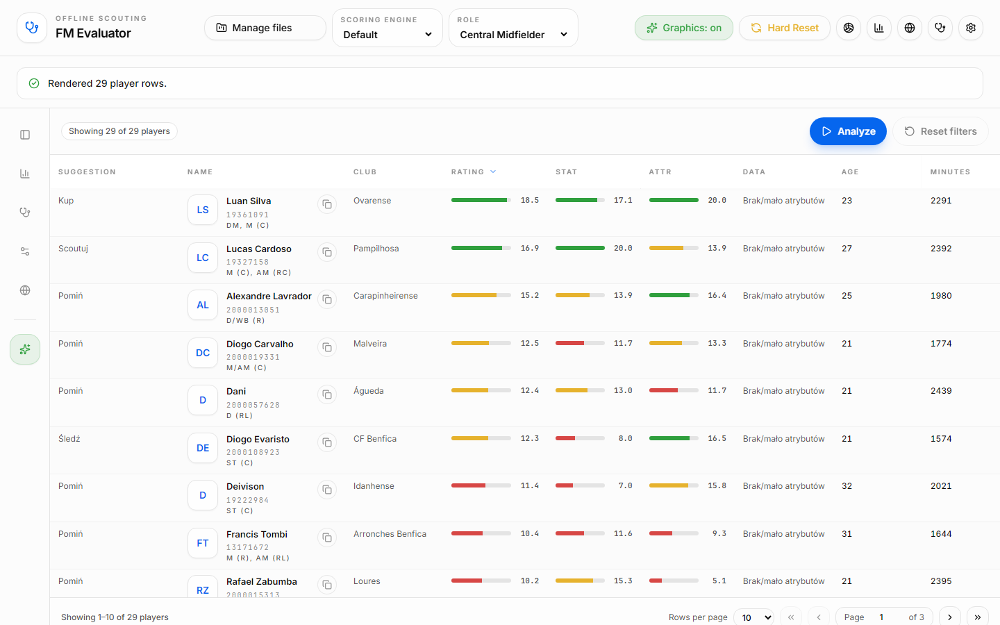
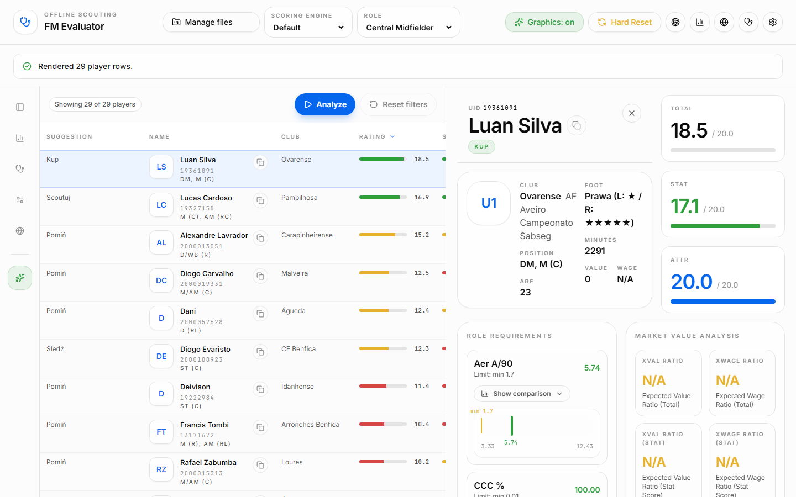

# FM Evaluator

[](https://github.com/visvaya/fm-evaluator/actions/workflows/ci.yml)

Find the players worth signing in your Football Manager save. Export player lists from the game, drop them into FM Evaluator, pick the role you need, and get a ranking that weighs both attributes and real match statistics, with the statistics corrected for league strength and team possession.

Everything runs in your browser. Your exports are read on your computer and never uploaded anywhere.

> **Not ready for real use yet.** The app is in a deep rebuild, its results have not been verified, and the interface shown below will be replaced. See [Status](#status).



## What it is built to do

- **Ranks players for a role.** Choose a role and every player gets an attribute score, a statistics score and a total, plus the role each player suits best.
- **Suggests what to do next.** A badge says whether a player looks worth buying, needs more scouting, is worth keeping an eye on, or can be skipped, based on how the player's numbers compare with the rest of the list.
- **Compares leagues fairly.** Volume statistics are scaled by a league difficulty coefficient, so 10 goals in a weaker league do not look the same as 10 goals in the Premier League. The list of leagues and their multipliers can be edited.
- **Accounts for possession.** Defensive actions depend on how much of the ball a team has; possession-adjusted columns correct for it. Team possession can be read from a screenshot of the league table with text recognition (OCR) instead of being typed in.
- **Shows value for money.** Ratios of score to transfer value and to wage point at bargains.
- **Combines exports.** An attributes view and a statistics view of the same players are merged into one row per player. Exports in 18 Football Manager interface languages are recognised.
- **Works offline.** After the first visit the app keeps working without a connection and can be installed as an app.



## How to use it

1. In Football Manager, open a player list (a squad, a scouting shortlist or a player search) and show the columns you want: attributes, statistics, or both.
2. Select the players and print the list to a web page (`Ctrl+P`, then save as a web page). You get an `.html` file.
3. Open FM Evaluator and drop the file (or several) onto the import area.
4. Pick a role. Sort, filter, pin columns and open a player for details.

## Status

An early prototype in a deep rebuild, not yet usable for decisions in a real save:

- **Rebuild in progress.** The code is moving from a single-page prototype to a typed, modular React app. Parts of the old layer are still active, and behaviour can change from one commit to the next.
- **Results not verified.** The scoring, the league coefficients, the possession adjustment and the import of exports have not yet been checked against a written specification or real saves. Rankings and suggestions can be wrong. Known gaps include columns of some older export layouts that are not recognised and a date order that is not detected (dates are read as day before month unless month first is chosen in the format dialog).
- **Before a redesign.** The current interface, including the screenshots above, is temporary. A new interface follows once the logic has been checked.
- **Not published.** There is no hosted version and no release; run it locally with the steps below.

Order of the work ahead: verify the logic, publish a first hosted version, then the redesign; the rebuild continues alongside. The interface is in Polish and English.

## Privacy

The app has no server side. Imported files are parsed in the browser, settings are stored in the browser's own storage (IndexedDB), and no data is sent to any server. All fonts, scripts and the OCR engine are served from the app itself, with no external CDNs.

## Running it locally

Requirements: Node.js 26 (at least the version in `engines` in `package.json`) and pnpm in the version pinned by `packageManager` (Node.js 26 no longer ships Corepack: run `npm install -g corepack` and `corepack enable`, or install that pnpm version directly).

```bash
pnpm install
pnpm run dev
```

The development server sends the security headers the app needs (cross-origin isolation for OCR in a worker). A production build (`pnpm run build`) must be served with the headers from `security_headers.json`; without them the app runs in a reduced mode without OCR.

## Development

Contributions are welcome: see `CONTRIBUTING.md` for the setup and the checks to run, and `docs/README.md` for the architecture and the documentation index. Security problems: `SECURITY.md`.

## License

The project's own code and documentation are released under the [MIT License](LICENSE). The test fixtures in `goldens/fixtures/` contain a few rows copied from Football Manager exports; the licence does not cover that game data.

---

_FM Evaluator is not affiliated with Sports Interactive or SEGA. Football Manager is a trademark of Sports Interactive Limited._
